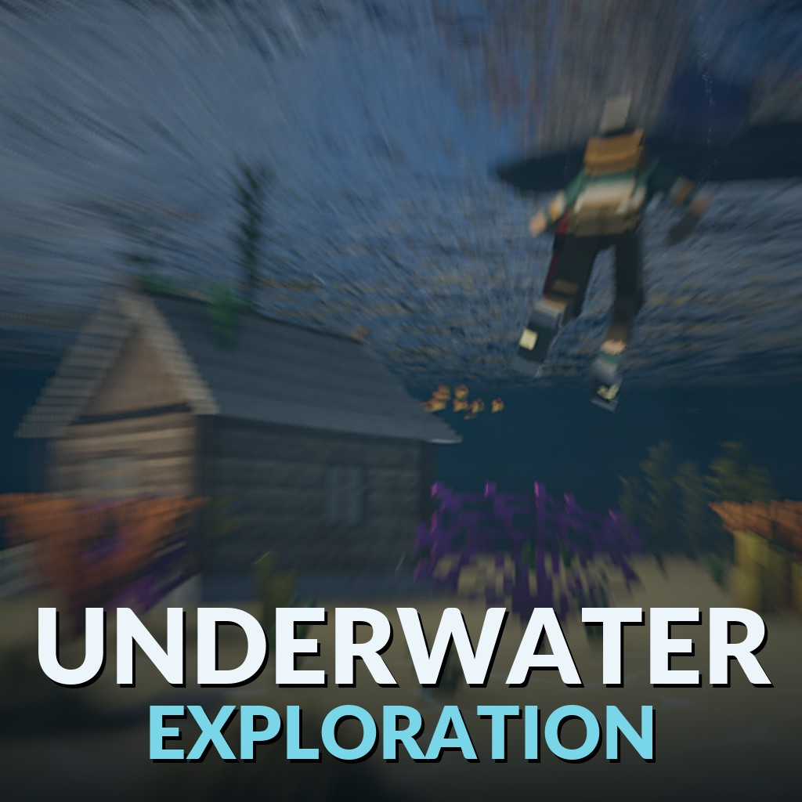

# Underwater Exploration

**Dive into any water** - a global mod for [Teardown](https://teardowngame.com).

Scuba diving on any map with water. Crouch in the water to dive, swim where you look, and explore what's down there
with an air tank. Nothing changes on dry land.

## Diving

- **Crouch** in the water to dive. Under water you swim where you look; **jump** and **crouch** go straight up and
  down, and with no input you hang still.
- An **air tank** lasts 60 seconds under water and refills at the surface. The HUD shows your air and depth.
- While you dive, the sledgehammer is swapped for the **blowtorch** (you get it back at the surface).

## The world under water

- **Light**: caustics ripple over whatever the sun reaches, and the deeper you go the darker, bluer and greyer it
  gets. Past about 25 m you need your **flashlight** (it is made stronger with depth, so it still lights things up).
- **Bubbles**: your breath, streams from the floor, and a boiling burst where an explosion or a shot goes off in the
  water.
- **Fish**: schools that swim around you and scatter when you come close.
- **Seaweed and corals**: kelp, seagrass and corals grow on the sea floor, swaying in the current.
- **Floating**: every loose object floats, hangs or sinks by its material: plastic comes up, wood drifts slowly or
  hangs, metal goes down. Objects nobody is near are put to sleep and moved to where they would have drifted when
  someone comes close, so a sea full of crates costs the host almost nothing.

## Multiplayer

The host turns it on under Global mods. The fish, seaweed and corals are drawn by each player's own game (the plants'
places come from a hash of the position, so everyone sees the same ones without anything being sent); the host pays
only for the swimming, the air and the floating objects.

## For mod and map makers

Other mods and maps can change the water's visibility, the amount of fish, seaweed and corals, the darkness, the
swim speed, the drowning time and more, with plain registry keys (`SetFloat("dive.fish", 3, true)`), or with tags on
a map's `<water>`. They can also read who is diving and how much air they have left.
**The full list: [API.md](API.md).**

## Install

Subscribe on the Steam Workshop, or clone this repository into `Documents/Teardown/mods/underwater exploration` and
enable it under Global mods. Online play needs the Workshop version: Teardown's multiplayer only allows published
mods.

## Files

- `main.lua`: the one script; its parts are modules: `dive.lua` (swimming, air, blowtorch, caustics, bubbles, the
  look, the HUD), `buoyancy.lua` (the floating objects, on the host), `fish.lua` and `flora.lua` (each player's own
  fish and plants).
- `images/`, `snd/`, `vox/`: the caustic light, bubbles, sounds, fish and plant models, all made for this mod.

## Credits

Made by AgeOfAlgorithms with Claude (Anthropic). MIT licence (`LICENSE`).
